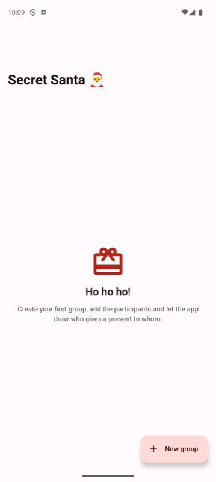
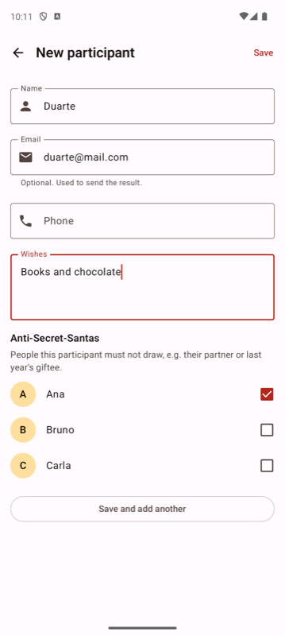
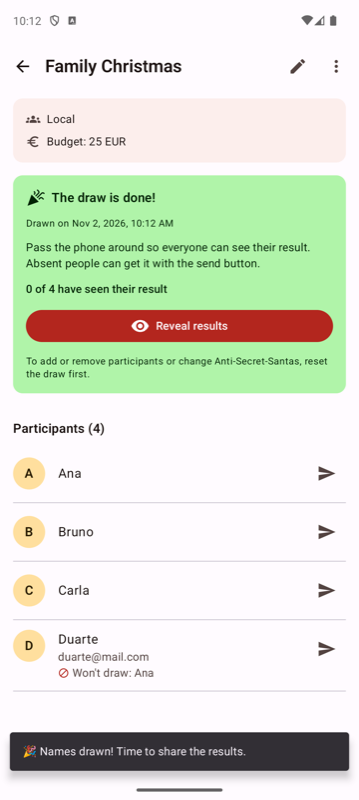
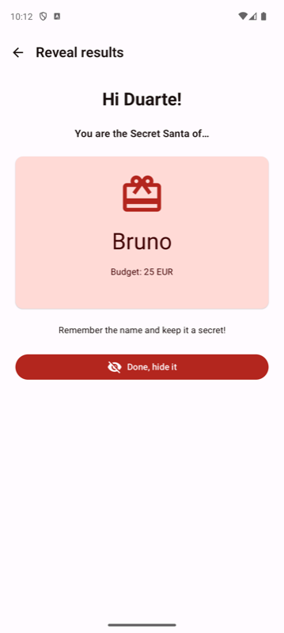
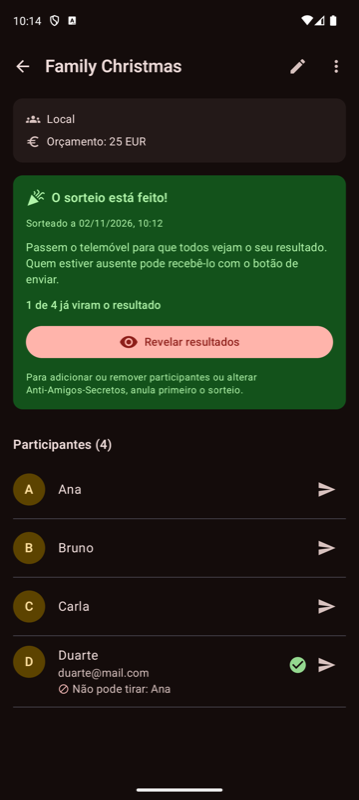
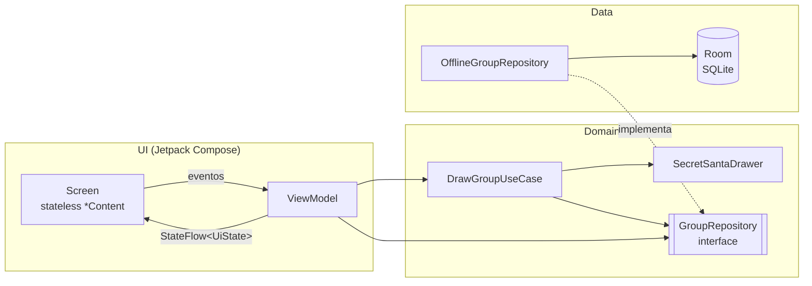

# 🎅 Secret Santa (Amigo Secreto)

Réplica, feita por engenharia reversa, da app [**Secret Santa App** (JHSV)](https://play.google.com/store/apps/details?id=net.jhsv.wichtelapp&hl=pt_PT),
desenvolvida em Kotlin + Jetpack Compose para a unidade curricular de **Android e Cloud**.

A app organiza sorteios de amigo secreto: cria grupos, adiciona participantes, define quem não pode
tirar quem ("Anti-Secret-Santas"), faz o sorteio e entrega o resultado a cada pessoa — em mão, passando
o telemóvel, ou à distância, por email, SMS ou outra app de mensagens.

<p align="center">
  
  
  
  
  
</p>

## Funcionalidades

Cada funcionalidade da app original (descrição na Google Play) e a forma como foi replicada:

| App original | Esta réplica |
|---|---|
| **Local-Secret-Santa**: o sorteio é feito com todos presentes; quem falta recebe por email | Modo **Local**: ecrã "Revelar resultados" em que cada pessoa toca no seu nome, confirma a identidade e revela o cartão em privado. Quem não está presente pode receber o resultado pelo botão de enviar |
| **Online-Secret-Santa**: todos recebem o resultado por mensagem | Modo **Online**: botão de enviar por participante (Email / SMS / outra app) com a mensagem já preenchida |
| **Gerador aleatório inteligente**: ninguém tira a si próprio | `SecretSantaDrawer`: amostragem aleatória uniforme + emparelhamento bipartido como recurso (ver abaixo) |
| **Anti-Secret-Santas** (casais, amigo do ano passado) | Lista de checkboxes por participante. Um participante que fique sem opções é identificado pelo nome |
| Sem registo | 100% offline, sem conta, sem permissões especiais |
| Vários grupos | Lista de grupos com contagem de participantes e estado do sorteio |
| Partilha por email, SMS ou mensageiros | `Intent` `ACTION_SENDTO` (mailto / smsto) e `ACTION_SEND` (chooser) |
| Lista de desejos | Campo "Desejos", mostrado no cartão revelado e incluído na mensagem enviada |
| Informação extra do grupo (data, orçamento…) | Data do evento (DatePicker), orçamento, local e notas |

Extras:

- **Proteção do sorteio**: depois do sorteio, não é possível adicionar/remover pessoas nem mudar exclusões
  sem anular o sorteio. Editar contactos ou desejos continua possível (não invalida o resultado).
- **Progresso**: "2 de 5 já viram o resultado" / "3 de 5 resultados enviados".
- **"Guardar e adicionar outro"** para inserir participantes rapidamente.
- Validação de nome obrigatório e duplicado, email e telemóvel.
- **Inglês e Português**, com idioma por app (`locales_config.xml`, Android 13+).
- **Tema claro/escuro** com paleta de Natal (Material 3) e ícone adaptativo próprio (com versão monocromática).
- **Backup automático** da base de dados (Auto Backup / transferência entre dispositivos).

## Arquitetura

A app segue a [arquitetura recomendada pela Google](https://developer.android.com/topic/architecture):
camadas UI → Domain → Data, fluxo de dados unidirecional (UDF) e uma única fonte de verdade.



- **UI**: cada ecrã tem um `XxxScreen` (liga ao ViewModel) e um `XxxContent` *stateless* com `@Preview`.
  O estado é exposto como `StateFlow` e recolhido com `collectAsStateWithLifecycle`.
- **ViewModels** recebem a rota de navegação por **injeção assistida do Hilt**, o que os torna testáveis em JVM
  sem Robolectric. O ecrã de revelação guarda o estado sensível em `SavedStateHandle` (sobrevive à rotação e à
  morte do processo).
- **Domain**: modelos puros Kotlin, o algoritmo de sorteio e o caso de uso. Não depende de Android.
- **Data**: Room com chaves estrangeiras `CASCADE`, transações (`withTransaction`), `Flow` reativo e
  esquema exportado em `app/schemas/` para futuras migrações.
- **DI**: Hilt (`DatabaseModule`, `RepositoryModule`). A UI depende apenas da interface `GroupRepository`,
  pelo que pode ser trocada por uma implementação cloud sem mexer nos ecrãs.

### Algoritmo de sorteio

`domain/draw/SecretSantaDrawer.kt`

1. Valida o mínimo de 3 participantes e deteta logo quem não tem nenhum destinatário possível.
2. **Amostragem por rejeição**: gera permutações aleatórias até encontrar uma válida (sem auto-sorteio e
   respeitando exclusões). Quando encontra, o resultado é **uniformemente distribuído** entre todos os
   sorteios válidos.
3. Se as restrições forem tão apertadas que as tentativas aleatórias falham, recorre ao **algoritmo de Kuhn**
   (emparelhamento perfeito num grafo bipartido, com listas baralhadas). Encontra sempre uma solução em
   tempo polinomial quando existe, e **prova** que é impossível quando não existe — nunca fica em ciclo infinito.

O `Random` é injetável, o que permite testes determinísticos.

## Stack

| Área | Tecnologia |
|---|---|
| Linguagem | Kotlin 2.4 (Kotlin integrado no AGP 9) |
| UI | Jetpack Compose, Material 3, Material Icons |
| Navegação | Navigation Compose com rotas *type-safe* (`kotlinx.serialization`) |
| Estado | ViewModel, `StateFlow`, Coroutines |
| Persistência | Room 2.8 (KSP) |
| DI | Hilt 2.60 (KSP) + `hilt-lifecycle-viewmodel-compose` |
| Testes | JUnit 4, kotlinx-coroutines-test, Turbine, AndroidX Test, Room in-memory |
| Build | Gradle 9.6 (Kotlin DSL), *version catalog* (`gradle/libs.versions.toml`), R8 no release |

`minSdk 34` · `targetSdk/compileSdk 37`

## Estrutura do projeto

```
app/src/main/java/com/example/secretsanta/
├── SecretSantaApplication.kt      # @HiltAndroidApp
├── MainActivity.kt                # edge-to-edge + NavHost
├── di/                            # módulos Hilt
├── domain/
│   ├── model/                     # Group, Participant, Assignment, DrawMode, GroupDetails
│   ├── repository/                # GroupRepository (contrato)
│   └── draw/                      # SecretSantaDrawer, DrawResult, DrawGroupUseCase
├── data/
│   ├── local/                     # Room: database, DAOs, entities, converters
│   ├── repository/                # OfflineGroupRepository
│   └── Mappers.kt                 # entity <-> domain
├── ui/
│   ├── navigation/                # rotas type-safe + NavHost
│   ├── theme/                     # cores, tipografia, tema claro/escuro
│   ├── components/                # componentes reutilizáveis
│   ├── groups/                    # lista de grupos
│   ├── groupedit/                 # criar/editar grupo
│   ├── groupdetail/               # detalhe, sorteio, envio de resultados
│   ├── participant/               # criar/editar participante + exclusões
│   └── reveal/                    # revelação no modo local
└── util/                          # mensagens, intents de partilha, datas, validação
```

## Como executar

Requisitos: Android Studio recente (com suporte a AGP 9.4), JDK 17+ e Android SDK 37.

```bash
./gradlew assembleDebug                 # compilar
./gradlew installDebug                  # instalar no emulador/dispositivo
./gradlew testDebugUnitTest             # testes unitários (JVM)
./gradlew connectedDebugAndroidTest     # testes instrumentados (precisa de emulador)
./gradlew lintDebug                     # análise estática
```

Ou abrir a pasta no Android Studio e correr a configuração `app`.

## Testes

- **34 testes unitários** (JVM):
  - `SecretSantaDrawerTest`: bijeção, ninguém tira a si próprio, exclusões sempre respeitadas,
    deteção de impossibilidade (incluindo casos não óbvios), recurso ao emparelhamento, aleatoriedade e
    determinismo com *seed*.
  - `DrawGroupUseCaseTest`, `GroupsViewModelTest`, `GroupDetailViewModelTest`,
    `ParticipantEditViewModelTest`, `RevealViewModelTest` com um `FakeGroupRepository` em memória.
  - `ValidationTest` (email e telemóvel).
- **4 testes instrumentados** (`OfflineGroupRepositoryTest`) sobre Room em memória: persistência,
  exclusões, invalidação do sorteio, estado revelado e eliminação em cascata.

## Privacidade

A app não pede permissões, não tem anúncios nem análise de utilização e não envia dados para nenhum
servidor: o envio de resultados é sempre feito pela app de email/SMS/mensagens escolhida pelo utilizador.

## Evolução possível (Cloud)

O repositório está isolado atrás de `GroupRepository`, por isso a componente cloud pode ser adicionada
sem alterar a UI, por exemplo:

- **Firebase Authentication** (anónima) + **Cloud Firestore** para sincronizar grupos entre dispositivos e
  permitir que cada participante veja só o seu resultado através de um código de convite;
- **Cloud Functions** para enviar os emails do modo online a partir do servidor (como a app original),
  sem o organizador ver o conteúdo da mensagem.

## Processo de desenvolvimento

Projeto desenvolvido por *vibe coding* com o Claude Code, a partir de um único prompt que pedia a
engenharia reversa da app original e boas práticas de Android. O processo seguido:

1. Análise da página da app na Google Play (descrição, funcionalidades, notas de versão e críticas, por
   exemplo o bug relatado de "não conseguir selecionar o último da lista" de exclusões, evitado aqui com uma
   lista simples de checkboxes);
2. Desenho da arquitetura e do modelo de dados;
3. Implementação por camadas (domain → data → UI);
4. Testes unitários e instrumentados, `lint` sem avisos de código;
5. Verificação manual num emulador Pixel 8 Pro (Android 14): criação de grupo, participantes, exclusões,
   sorteio, revelação, envio por email, idioma português e modo escuro.
